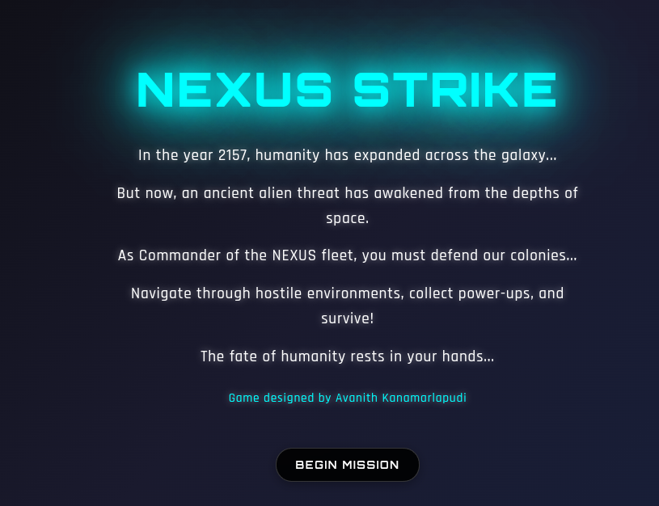
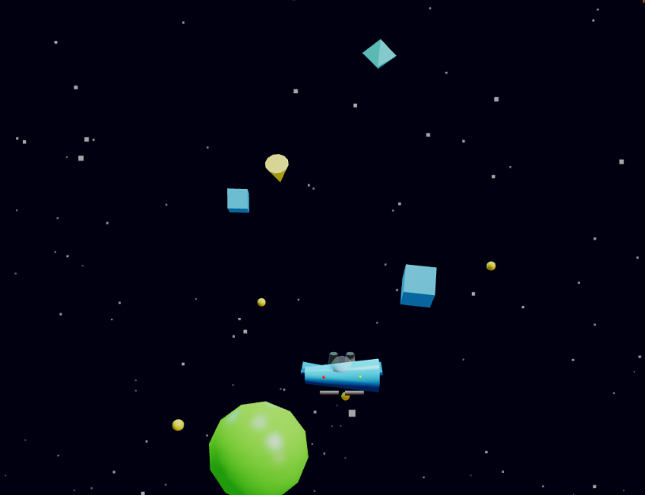

# NEXUS STRIKE - Advanced 3D Space Shooter

A 3D space shooter built with Three.js. Fight through four environments, collect power-ups, and climb the leaderboard.

## Screenshots

### Starting screen

<p align="center">
  
</p>

### In game

<p align="center">
  
</p>

## Presentation

**[View Project Presentation](https://slides.com/avanith/game)**

## Play

**[Play NEXUS STRIKE](https://avanith12.github.io/nexus-strike-game/)**

Desktop and laptop with a keyboard and mouse. Touch controls are not in the game yet.

## Features

- Four maps: Space Station, Asteroid Field, Nebula, and 3D Geometric
- Enemy types with different behavior, plus boss fights
- Power-ups: health, weapon upgrades, speed boost, and shield
- Combo multiplier, accuracy tracking, and a saved leaderboard
- Minimap, follow or free camera, and burst fire
- Procedural music and sound effects from the Web Audio API (no audio files)

## Controls

- **WASD** — move
- **Q / E** — down / up
- **Space** or **left click** — shoot
- **Shift** — boost
- **Mouse** — look around in free camera
- **C** — toggle follow / free camera
- **V** — burst fire
- **P** — pause
- **M** — mute
- **R** — reload

## Run locally

Open `html/index.html` with a local server. The root `index.html` redirects there.

```bash
python3 -m http.server 8000
```

Then open `http://localhost:8000`.

## Project structure

```
nexus-strike-game/
├── index.html              # Redirects to html/index.html
├── html/index.html         # Game page
├── css/style.css           # Styles
├── js/space-shooter.js     # Game
├── js/ui.js                # Intro, controls, and map panel
├── starting.png            # Start screen
├── game.png                # In-game screenshot
├── favicon.png
├── package.json
├── LICENSE
└── README.md
```

## Technologies

- Three.js and WebGL
- JavaScript
- HTML and CSS
- OrbitControls
- Web Audio API
- localStorage for the leaderboard

## License

MIT. See [LICENSE](LICENSE).
